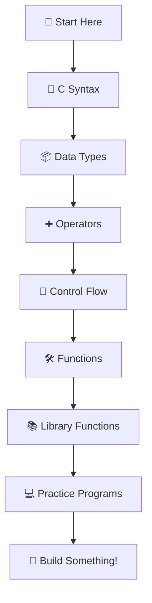

# 🌸⚡ AlgoBloom | Quick Reference Lab

### Your pocket-sized C programming companion!

> 😵 Forgot a syntax?  
> 🤔 Confused between two operators?  
> 😭 Fighting with a compiler error?
>
> Take a breath. You're in the right place! 💗

Welcome to the **Quick Reference Lab**, where programming knowledge is organised for quick access, practical exploration, and continuous learning.

This isn't a textbook chapter. It's your developer's reference desk.

**🌱 Learn → 🧠 Think → 💻 Experiment → 🚀 Build**

---

## 🎮 ENTER THE QUICK REFERENCE LAB

| Learning Station | Your Mission | Explore |
|---|---|---|
| 🧩 Syntax Station | Understand C program structure and syntax | [🚀 Open](resources/01_C_Syntax_Reference.md) |
| 📦 Data Station | Explore data types and format specifiers | [🚀 Open](resources/02_Data_Types_and_Format_Specifiers.md) |
| ➕ Operator Station | Understand operators and precedence | [🚀 Open](resources/03_Operators_and_Precedence.md) |
| 🔀 Control Station | Explore decisions and loops | [🚀 Open](resources/04_Control_Flow_Reference.md) |
| 🛠️ Function Station | Understand reusable functions | [🚀 Open](resources/05_Functions_Reference.md) |
| 📚 Library Station | Discover useful C library functions | [🚀 Open](resources/06_Common_C_Library_Functions.md) |

*Some stations are still under construction. We're growing this laboratory one resource at a time! 🌱*

---

## 🗺️ YOUR LEARNING JOURNEY

Not sure where to begin?

Follow this learning path:



---

## 🧠 THE INTERACTIVE ZONE

Don't just read. Think!

Welcome to your mini coding arena! 🎮

Three challenges are waiting for you. Try solving them before revealing the answers.

### 🎯 Challenge 01 — Predict the Output

<details>
<summary>💻 Open Challenge 01 — Integer Division</summary>

What will this program display?

```c
#include <stdio.h>

int main(void)
{
    int x = 10;
    int y = 3;

    printf("%d", x / y);

    return 0;
}
```

**Your prediction:**

- [ ] A. 3
- [ ] B. 3.33
- [ ] C. 4
- [ ] D. Compilation error

<details>
<summary>🤯 Reveal the answer</summary>

🎉 **Correct answer: A. 3**

Both operands are integers.

C performs integer division, which discards the fractional part.

```text
10 / 3 = 3
```

😲 Want to see something interesting?

Change the expression:

```c
printf("%f", (double)x / y);
```

Now the output is approximately:

```text
3.333333
```

**🧠 What did you discover?**

The data types of operands can affect the result of an operation!

</details>
</details>

---

### 🐞 Challenge 02 — Debugging Detective

<details>
<summary>🔍 Open Challenge 02 — Find the Missing Symbol</summary>

Someone wrote this program:

```c
#include <stdio.h>

int main(void)
{
    int age = 18

    printf("%d", age);

    return 0;
}
```

Can you find the mistake?

**Your mission:**

- [ ] Check the variable declaration.
- [ ] Check the format specifier.
- [ ] Check the statement terminator.
- [ ] Check the header file.

<details>
<summary>😵 Reveal the bug</summary>

The semicolon is missing after:

```c
int age = 18;
```

**Corrected program:**

```c
#include <stdio.h>

int main(void)
{
    int age = 18;

    printf("%d", age);

    return 0;
}
```

**Expected output:**

```text
18
```

😂 One tiny symbol. One compiler complaint. Welcome to C programming!

**Developer lesson:** Always inspect the line indicated by the compiler and the surrounding code.

</details>
</details>

---

### 🤔 Challenge 03 — Assignment vs Comparison

<details>
<summary>🧩 Open Challenge 03 — Understand the Difference</summary>

What is the difference between these expressions?

**Expression A**

```c
a = 10;
```

**Expression B**

```c
a == 10;
```

Before revealing the answer, think about what each operator does.

<details>
<summary>💡 Reveal the explanation</summary>

| Operator | Meaning | Purpose |
|---|---|---|
| `=` | Assignment | Stores a value |
| `==` | Equality comparison | Checks whether two values are equal |

**Example:**

```c
#include <stdio.h>

int main(void)
{
    int a = 5;

    a = 10;

    if (a == 10)
    {
        printf("Condition is true!");
    }

    return 0;
}
```

**Expected output:**

```text
Condition is true!
```

🤯 **Remember:** Assignment changes a variable's value. Comparison evaluates a condition.

</details>
</details>

---

## 🔬 EXPERIMENT CORNER

Try changing code instead of simply memorising it.

| Experiment | What to investigate |
|---|---|
| Integer division | What happens when `7 / 2` is evaluated? |
| Floating-point division | Compare `7 / 2` and `7.0 / 2` |
| Increment | Compare `i++` and `++i` |
| Conditions | What happens when a condition is false? |
| Loops | What happens if a loop condition never becomes false? |
| Arrays | What happens when you access an invalid index? |

### 🧪 Your Experiment Report

After experimenting, record:

1. **My prediction:** What did I expect?
2. **Actual result:** What happened?
3. **My explanation:** Why did it happen?
4. **My discovery:** What did I learn?

This is how developers develop intuition. 🧠

<details>
<summary>💗 Want an experiment template?</summary>

Copy this into your personal learning notes:

```text
EXPERIMENT NAME:

1. My prediction:

2. Program modification:

3. Actual output:

4. Why did this happen?

5. What did I discover?

6. What would I experiment with next?
```

</details>

---

## 💻 THE CODE PLAYGROUND

Understanding a concept is good.

Writing a program using that concept is better!

Explore these beginner-friendly demonstrations:

| Program | Concepts Practised |
|---|---|
| Hello AlgoBloom | Program structure and output |
| User Profile | Variables and input |
| Simple Calculator | Arithmetic operators |
| Even-Odd Checker | Conditions and modulus |
| Multiplication Table | Loops |
| Function-Based Calculator | Functions and modular programming |

📂 **Program directory:** `resources/programs/`

### 🚀 Run Your First Program

Example using GCC:

```powershell
gcc -std=c17 -Wall -Wextra -Wpedantic 01_hello_algobloom.c -o hello.exe

.\hello.exe
```

<details>
<summary>😲 What should you check when a program fails?</summary>

- Is the source filename correct?
- Is GCC installed and accessible?
- Are there missing semicolons?
- Are the header files included?
- Are variables declared correctly?
- Did you read the compiler's error message?

😅 Remember: A compiler error is feedback, not a personal attack!

</details>

---

## 🏆 PERSONAL PROGRESS TRACKER

Track your journey by editing these checkboxes.

- [ ] 🧩 Completed C syntax reference.
- [ ] 📦 Revised data types.
- [ ] ➕ Practised operators.
- [ ] 🔀 Understood control flow.
- [ ] 🛠️ Practised functions.
- [ ] 📚 Explored library functions.
- [ ] 🎯 Completed all interactive challenges.
- [ ] 🐞 Solved debugging exercises.
- [ ] 🔬 Performed at least three experiments.
- [ ] 💻 Executed all six demonstration programs.

**GitHub tip:** These checkboxes are editable Markdown, not automatically synchronised progress tracking.

---

## 💬 THE LEARNER'S CORNER

AlgoBloom is built for learners, and learners should help shape it.

Have you:

- 😍 Found a better way to explain a concept?
- 🤯 Discovered an interesting C behaviour?
- 🥺 Found an incorrect example?
- 💡 Thought of a new challenge?
- 🚀 Created a useful demonstration?

Contribute your ideas!

- [🐞 Report a bug](https://github.com/SnehaCS148/AlgoBloom/issues/new)
- [💡 Suggest an improvement](https://github.com/SnehaCS148/AlgoBloom/issues/new)
- [🌱 Explore the repository](https://github.com/SnehaCS148/AlgoBloom)

---

## 🌐 EXPLORE THE ALGOBLOOM ECOSYSTEM

| Destination | Purpose |
|---|---|
| 🏠 [Chapter 01](../../README.md) | Learn C Programming Fundamentals |
| 📚 [Resource Library](../README.md) | Explore all chapter resources |
| 🌳 [AlgoBloom Home](../../../README.md) | Return to the main repository |

---

## 💗 A LITTLE REMINDER BEFORE YOU LEAVE

> 😭 Your first program may have 10 errors.
>
> 😵 Your second program may have 5.
>
> 😂 Your third program may compile but produce the wrong output.
>
> 🤯 And one day, you'll look at your old code and wonder how you ever wrote it.
>
> That's progress. Keep growing!

**🌸 AlgoBloom — Where Logic Grows Into Efficient Code.**