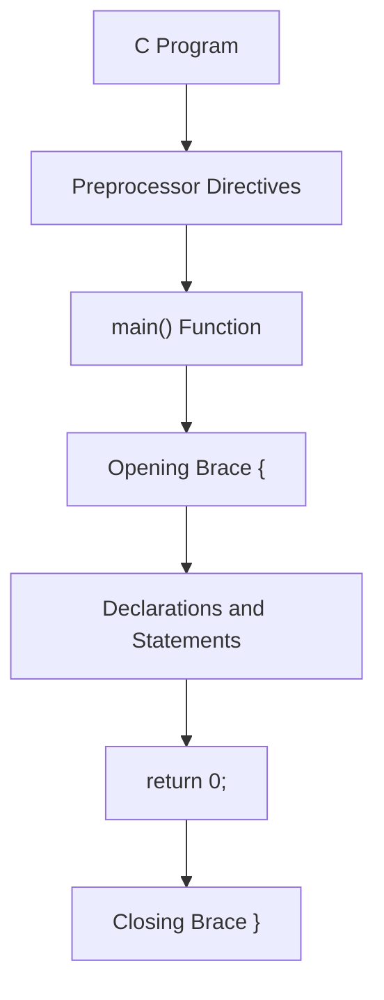

# 🧩 C Syntax Reference
### Your first stop for understanding the language of C! 🌸

> 😵 Looking at C code and wondering what all those symbols mean?
>
> 🤔 Why does every program need `main()`?
>
> 🐞 Why does one missing semicolon cause so much trouble?
>
> Take a breath. Let's decode C, one piece at a time! 💗

Welcome to the **C Syntax Reference**, your practical guide to writing, reading and understanding C programs.

This resource is designed as a developer's reference—not a chapter to memorise.

**🌱 Learn → 🧠 Understand → 💻 Experiment → 🚀 Apply**

---

## 🎮 01. ENTER THE SYNTAX LAB

| Learning Station | What You'll Discover |
|---|---|
| 🏗️ Program Structure | Anatomy of a C program |
| 📦 Header Files | Why we include libraries |
| 🚪 `main()` Function | Where program execution begins |
| 📝 Statements | Instructions given to the computer |
| 🧱 Blocks | How braces group instructions |
| 💬 Comments | How developers document code |
| 🔤 Identifiers | Naming variables and functions |
| ⚠️ Syntax Errors | Common mistakes and debugging |

---

## 🏗️ 02. ANATOMY OF A C PROGRAM

Let's begin with a simple program.

```c
#include <stdio.h>

int main(void)
{
    printf("Hello, AlgoBloom!");

    return 0;
}
```

### 🔍 Understand Every Component

| Component | Purpose |
|---|---|
| `#include <stdio.h>` | Includes standard input/output declarations |
| `int` | Specifies the return type of `main()` |
| `main()` | Defines the program's entry-point function |
| `{ }` | Marks the beginning and end of a block |
| `printf()` | Displays formatted output |
| `;` | Terminates a statement |
| `return 0;` | Indicates successful termination |

### 🗺️ Program Structure Map



### 🧠 Important Concept

A C program may contain multiple functions, declarations and other components.

However, execution of a hosted C program begins at its `main()` function.

---

## 📦 03. HEADER FILES

A header file provides declarations that allow your program to use library facilities.

Example:

```c
#include <stdio.h>
```

This header provides declarations for standard input/output functions such as:

- `printf()` — formatted output.
- `scanf()` — formatted input.
- `getchar()` — reads a character.
- `putchar()` — writes a character.

### 🔬 Experiment

What happens if you remove:

```c
#include <stdio.h>
```

Try compiling the program again.

You may receive compiler diagnostics because the declarations for the input/output functions are missing.

**Developer lesson:** Include the appropriate header for the library facilities you use.

---

## 🚪 04. UNDERSTANDING main()

The `main()` function is the entry point of a hosted C program.

Example:

```c
int main(void)
{
    printf("Program started!");

    return 0;
}
```

Let's decode its declaration:

| Part | Meaning |
|---|---|
| `int` | Function returns an integer |
| `main` | Function name |
| `void` | No parameters |
| `{ }` | Function body |
| `return 0;` | Successful termination status |

### 🤔 Why `return 0`?

The operating environment receives the termination status of the program.

Conventionally:

- `0` indicates successful execution.
- A non-zero value generally indicates an error or abnormal termination.

---

## 📝 05. STATEMENTS AND SEMICOLONS

A statement represents an instruction in a C program.

Example:

```c
int age = 18;
printf("%d", age);
return 0;
```

Notice the semicolons.

Most ordinary C statements end with a semicolon.

### ⚠️ Common mistake

Incorrect:

```c
int age = 18
printf("%d", age);
```

Correct:

```c
int age = 18;
printf("%d", age);
```

😵 One missing symbol can prevent compilation!

**Remember:** A semicolon terminates a statement. It does not normally follow a function definition or a control-flow block.

---

## 🧱 06. BLOCKS AND BRACES

Curly braces `{ }` group declarations and statements into a block.

Example:

```c
int main(void)
{
    int marks = 95;

    if (marks >= 90)
    {
        printf("Excellent!");
    }

    return 0;
}
```

Here:

- The outer braces define the body of `main()`.
- The inner braces define the body of the `if` statement.

### 🧠 Why are blocks useful?

They help organise code and define scopes.

A variable declared inside a block generally has block scope and cannot be accessed outside that scope.

---

## 💬 07. COMMENTS IN C

Comments help developers explain code.

The compiler ignores comments during normal compilation.

### Single-line comment

```c
// This is a single-line comment

int age = 18;
```

### Multi-line comment

```c
/*
   This is a multi-line comment.
   It can contain several lines.
*/

int marks = 95;
```

### 💡 Professional Tip

Good comments explain **why** something is done, especially when the reasoning is not obvious.

Avoid comments that simply repeat what the code already says.

---

## 🔤 08. IDENTIFIERS AND NAMING RULES

Identifiers are names used for program elements such as variables and functions.

Example:

```c
int studentAge = 20;
float accountBalance = 1500.50f;
```

Here, `studentAge` and `accountBalance` are identifiers.

### Identifier Rules

1. An identifier may contain letters, digits and underscores.
2. It cannot begin with a digit.
3. Spaces are not allowed.
4. C keywords cannot be used as identifiers.
5. C is case-sensitive.

### Examples

| Identifier | Valid? | Reason |
|---|---|---|
| `studentAge` | ✅ | Valid name |
| `_count` | ✅ | Begins with underscore |
| `age2` | ✅ | Digit appears after first character |
| `2age` | ❌ | Begins with a digit |
| `student age` | ❌ | Contains a space |
| `int` | ❌ | Reserved keyword |
| `total_marks` | ✅ | Valid name |

### 🌟 Naming Convention

Prefer meaningful names.

```c
int x = 18;
```

Compared with:

```c
int studentAge = 18;
```

The second example communicates intent more clearly.

---

## 🧪 09. COMPLETE PRACTICAL DEMONSTRATION

Let's combine what we've learned into a small student information program.

```c
#include <stdio.h>

int main(void)
{
    // Declare student information
    char initial = 'S';
    int age = 20;
    float marks = 92.5f;

    // Display student information
    printf("Student Initial: %c\n", initial);
    printf("Age: %d\n", age);
    printf("Marks: %.2f\n", marks);

    return 0;
}
```

### Expected Output

```text
Student Initial: S
Age: 20
Marks: 92.50
```

### 🔍 Concepts Identified

| Code Element | Concept |
|---|---|
| `#include` | Header file |
| `main()` | Entry-point function |
| `char` | Character data type |
| `int` | Integer data type |
| `float` | Floating-point data type |
| `printf()` | Output |
| `//` | Single-line comment |
| `\n` | Newline escape sequence |
| `%.2f` | Displays two digits after decimal point |

---

## 🐞 10. DEBUGGING DETECTIVE

A beginner has written this program:

```c
#include <stdio.h>

int main(void)
{
    int age = 20

    printf("Age: %d\n", age)

    return 0;
}
```

😵 Something is wrong!

### 🎯 Your Mission

Identify the mistakes before revealing the solution.

- [ ] Check the variable declaration.
- [ ] Check the output statement.
- [ ] Check the braces.
- [ ] Check the return statement.

<details>
<summary>🤯 Reveal the mistakes</summary>

Two semicolons are missing.

Incorrect:

```c
int age = 20

printf("Age: %d\n", age)
```

Correct:

```c
int age = 20;

printf("Age: %d\n", age);
```

**Corrected program:**

```c
#include <stdio.h>

int main(void)
{
    int age = 20;

    printf("Age: %d\n", age);

    return 0;
}
```

**Output:**

```text
Age: 20
```

🎉 Debugging is not magic. It is systematic problem-solving!

</details>

---

## 🎯 11. PREDICT THE OUTPUT

Try these challenges without running the code first.

### Challenge 01 — Statement Order

<details>
<summary>🧩 Open Challenge 01</summary>

What will this program display?

```c
#include <stdio.h>

int main(void)
{
    printf("A");
    printf("B");

    return 0;
}
```

- [ ] A. A B
- [ ] B. AB
- [ ] C. A and B on separate lines
- [ ] D. Compilation error

<details>
<summary>💡 Reveal the answer</summary>

**Correct answer: B. AB**

Both `printf()` calls display their output without automatically adding a newline.

</details>
</details>

### Challenge 02 — Newline

<details>
<summary>🌱 Open Challenge 02</summary>

What will this display?

```c
#include <stdio.h>

int main(void)
{
    printf("Hello\n");
    printf("World");

    return 0;
}
```

<details>
<summary>🤯 Reveal the answer</summary>

```text
Hello
World
```

`\n` moves the output cursor to a new line.

</details>
</details>

### Challenge 03 — Comments

<details>
<summary>💬 Open Challenge 03</summary>

Will the following program display the comment?

```c
#include <stdio.h>

int main(void)
{
    // This is a comment

    printf("Hello!");

    return 0;
}
```

<details>
<summary>💗 Reveal the answer</summary>

No.

Comments are ignored by the compiler during normal compilation.

Output:

```text
Hello!
```

</details>
</details>

---

## 🔬 12. EXPERIMENT CORNER

Now modify the practical demonstration.

| Experiment | Your Task |
|---|---|
| Experiment 01 | Change the student's age. |
| Experiment 02 | Add a second `printf()` statement. |
| Experiment 03 | Remove a semicolon and observe compiler diagnostics. |
| Experiment 04 | Change the order of output statements. |
| Experiment 05 | Add a meaningful comment. |
| Experiment 06 | Rename variables using better identifiers. |

### 📝 Experiment Journal

Record your discoveries:

```text
EXPERIMENT NAME:

1. My prediction:

2. Code modification:

3. Actual output:

4. Why did this happen?

5. What did I discover?

6. What will I try next?
```

---

## 💻 13. COMPILE AND RUN

Save the practical demonstration as:

`01_student_information.c`

Open PowerShell in the directory containing the file.

Compile:

```powershell
gcc -std=c17 -Wall -Wextra -Wpedantic 01_student_information.c -o student.exe
```

Run:

```powershell
.\student.exe
```

### 😵 If compilation fails

Check:

- Is the filename correct?
- Is GCC installed?
- Did you include the required header?
- Are all statements terminated correctly?
- Are the braces balanced?
- Did you read the compiler diagnostics?

Remember: A compiler error is feedback, not a personal attack! 😂

---

## 🏆 14. KNOWLEDGE CHECKPOINT

Before leaving this station, make sure you can:

- [ ] Explain the structure of a basic C program.
- [ ] Identify the purpose of a header file.
- [ ] Explain the role of `main()`.
- [ ] Differentiate statements and blocks.
- [ ] Identify where semicolons are required.
- [ ] Write single-line and multi-line comments.
- [ ] Identify valid and invalid identifiers.
- [ ] Compile and execute a C program.
- [ ] Debug basic syntax errors.
- [ ] Predict simple program output.

---

## 💬 15. YOUR TURN — CONTRIBUTE TO ALGOBLOOM

Found a mistake? Have a better explanation? Created an interesting experiment?

Share your ideas!

- 🐞 [Report a bug](https://github.com/SnehaCS148/AlgoBloom/issues/new)
- 💡 [Suggest an improvement](https://github.com/SnehaCS148/AlgoBloom/issues/new)
- 🌳 [Explore AlgoBloom](https://github.com/SnehaCS148/AlgoBloom)

---

## 🚀 NEXT LEARNING STATION

Congratulations! You've completed the first syntax exploration.

But there's more to discover.

**Next up:**

📦 [Data Types and Format Specifiers](02_Data_Types_and_Format_Specifiers.md)

Understand how C stores information and how to communicate that information through input and output.

---

> 🌸 You don't become a programmer by memorising every symbol.
>
> 🧠 You become one by understanding what each symbol does.
>
> 💻 Write. Break. Debug. Experiment. Repeat.
>
> 🚀 Keep growing, AlgoBloom learner!

**AlgoBloom — Where Logic Grows Into Efficient Code.**